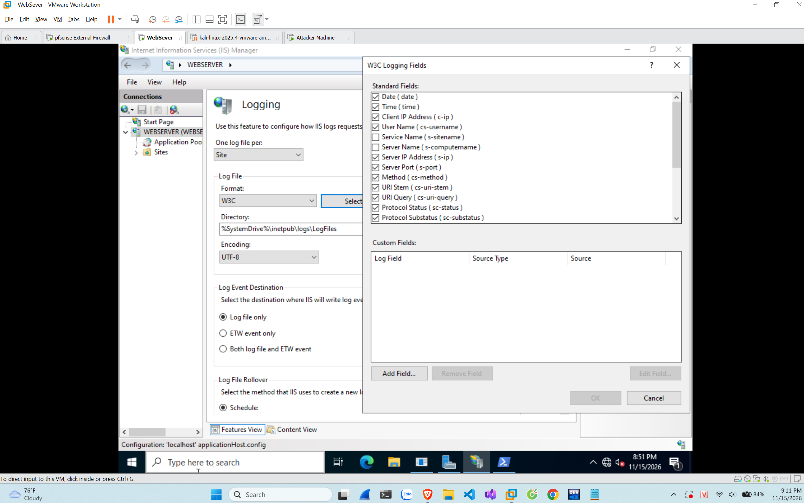
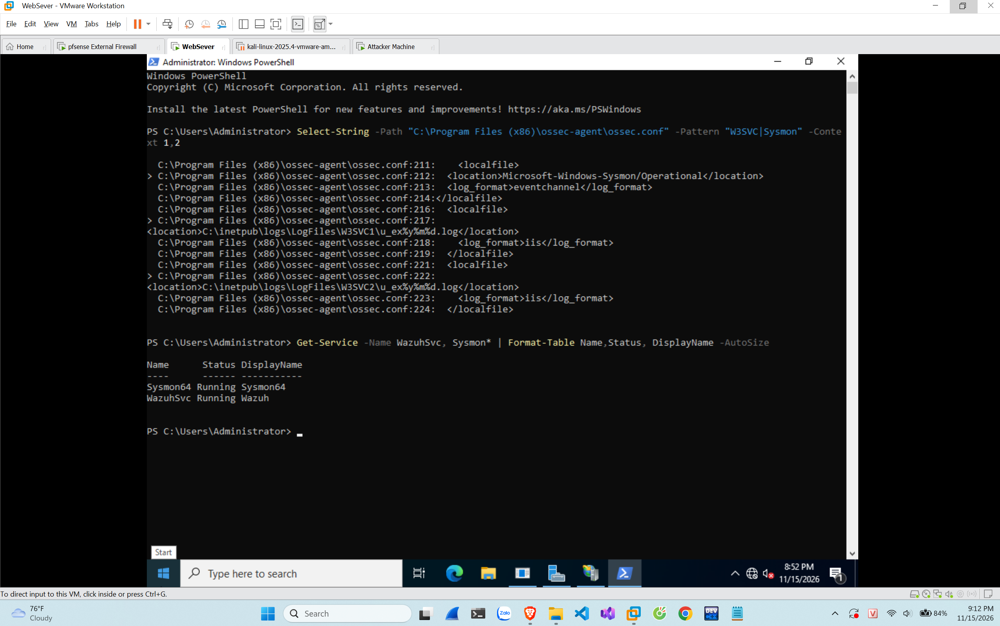
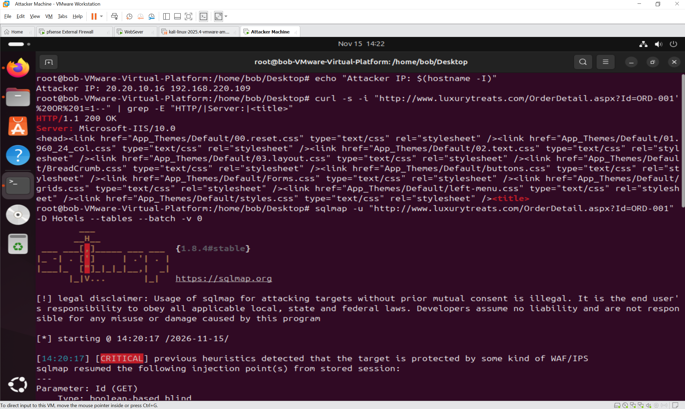
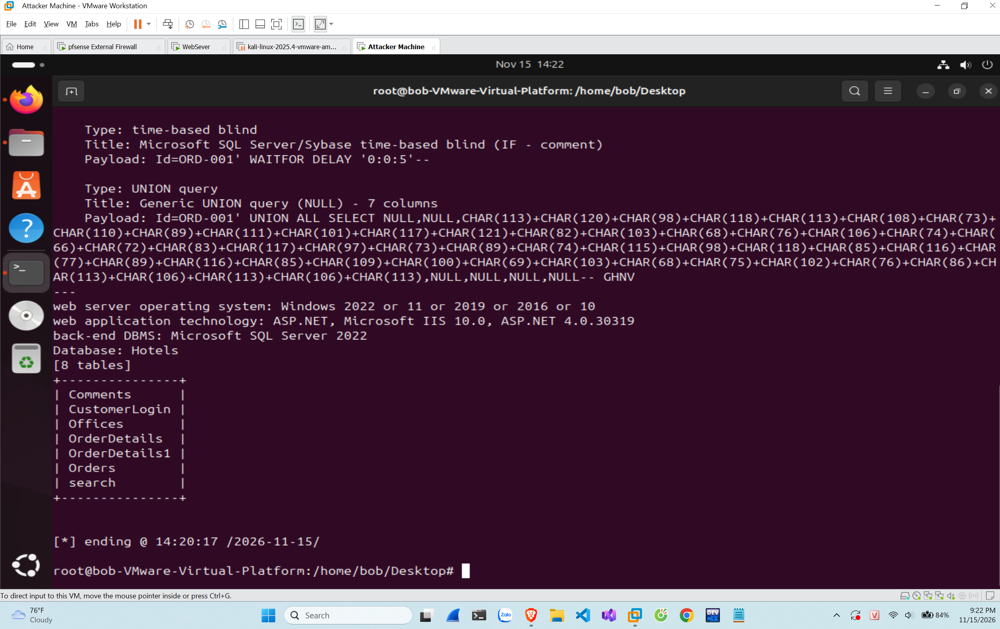
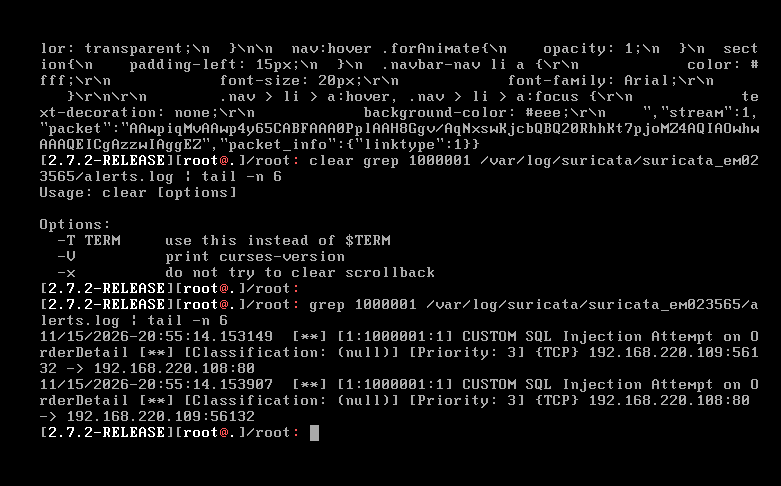
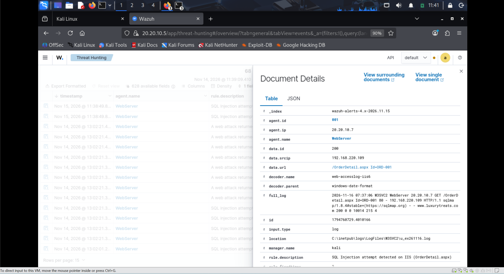

# Incident Response Report: IR-002 — Khai thác & Phát hiện tấn công SQL Injection (IIS + SQL Server)

## Thông tin tổng quan sự cố (Incident Metadata)

| Thuộc tính | Chi tiết |
| :--- | :--- |
| **Mã sự cố (Incident ID)** | `IR-002` |
| **Thời gian ghi nhận** | 15/11/2026 |
| **Mức độ nghiêm trọng** | **High** (Wazuh Alert Level `10`) |
| **Kỹ thuật tấn công** | SQL Injection (Error-based, Time-based Blind, UNION-based) |
| **Ánh xạ MITRE ATT&CK** | `T1190` — Exploit Public-Facing Application |
| **Mục tiêu bị tấn công** | `WebServer` (`20.20.10.7`) — `http://www.luxurytreats.com/OrderDetail.aspx` |
| **IP nguồn tấn công** | `192.168.220.109` |
| **Hệ thống phát hiện** | pfSense Suricata NIDS (`em023565`), IIS W3C Logs (`W3SVC2`), Wazuh SIEM (`20.20.10.5`) |
| **Trạng thái** | Đã cô lập & Khắc phục (Contained & Remediated) |

---

## 1. Tóm tắt điều hành (Executive Summary)

Ngày 15/11/2026, hệ thống giám sát phát hiện luồng truy vấn khai thác lỗ hổng **SQL Injection** xuất phát từ địa chỉ IP `192.168.220.109` nhắm vào tham số `Id` trên trang `/OrderDetail.aspx` của máy chủ web `www.luxurytreats.com` (`20.20.10.7`). Do ứng dụng ASP.NET nối chuỗi trực tiếp dữ liệu đầu vào vào câu truy vấn SQL, kẻ tấn công đã trích xuất thành công danh sách 8 bảng trong cơ sở dữ liệu `Hotels` trên Microsoft SQL Server 2022.

Ở lớp mạng biên, **Suricata NIDS** trên pfSense kích hoạt cảnh báo chữ ký tùy chỉnh `1:1000001:1`. Ở lớp máy chủ, nhật ký truy cập **IIS (`W3SVC2`)** đẩy về **Wazuh SIEM** đã kích hoạt quy tắc tùy chỉnh `100101` (Level 10, gắn nhãn MITRE `T1190`).

---

## 2. Diễn biến tấn công & Tương quan log (Timeline & Telemetry Correlation)

| Mốc thời gian | Nguồn dữ liệu | Mô tả sự kiện |
| :--- | :--- | :--- |
| `2026-11-15 15:38:05` | Attacker (`192.168.220.109`) | Chạy công cụ tự động (`sqlmap/1.8.4`) rà quét `/OrderDetail.aspx?Id=ORD-001` và liệt kê 8 bảng của database `Hotels`. |
| `2026-11-15 20:55:14` | pfSense Suricata (`em023565`) | Kích hoạt cảnh báo NIDS `[1:1000001:1] CUSTOM SQL Injection Attempt on OrderDetail` (`192.168.220.109:56132` tới `192.168.220.108:80`). |
| `2026-11-16 07:37:06` (UTC) | IIS WebServer (`W3SVC2`) | Ghi nhận các yêu cầu HTTP mang User-Agent `sqlmap/1.8.4` và payload SQLi trong tệp `C:\inetpub\logs\LogFiles\W3SVC2\u_ex261116.log`. |
| `2026-11-15 11:38:49` | Wazuh SIEM (`20.20.10.5`) | Phân tích log IIS và kích hoạt quy tắc `100101` (`SQL Injection attempt detected on IIS (OrderDetail.aspx)`, Level `10`, `T1190`). |


---

## 3. Phân tích kỹ thuật & Điều tra số (Forensic Analysis)

### 3.1 Khai thác ứng dụng & Liệt kê cơ sở dữ liệu
* **Điểm cuối tồn tại lỗ hổng:** `GET /OrderDetail.aspx?Id=ORD-001`
* **Các mẫu payload ghi nhận được:**
  * Boolean/Error-based: `Id=ORD-001' OR 1=1--`
  * Time-based blind: `Id=ORD-001' WAITFOR DELAY '0:0:5'--`
  * UNION-based (7 cột): `Id=ORD-001' UNION ALL SELECT NULL,NULL,...`
* **Cấu trúc database `Hotels` bị lộ:** `Comments`, `CustomerLogin`, `Offices`, `OrderDetails`, `OrderDetails1`, `Orders`, `Orders1`, `search`.

### 3.2 Phát hiện tại lớp mạng biên (Suricata NIDS)
Quy tắc tùy chỉnh SID `1000001` trên giao diện `em023565` của pfSense đã bắt được từ khóa SQL trong URI gửi tới `OrderDetail.aspx`:
```text
11/15/2026-20:55:14.153149  [**] [1:1000001:1] CUSTOM SQL Injection Attempt on OrderDetail [**] [Classification: (null)] [Priority: 3] {TCP} 192.168.220.109:56132 -> 192.168.220.108:80
```

### 3.3 Thu thập log máy chủ & Viết luật phát hiện trên Wazuh SIEM
* **Cấu hình Wazuh Agent:** Cập nhật `C:\Program Files (x86)\ossec-agent\ossec.conf` trên `WebServer` (`agent.id: 001`) để thu thập nhật ký W3C từ `C:\inetpub\logs\LogFiles\W3SVC2\u_ex*.log`.
* **Quy tắc phát hiện (`local_rules.xml`):** Bổ sung rule PCRE2 `100101` (Level 10) nhận diện không phân biệt hoa thường các từ khóa `OR`, `UNION`, `SELECT`, `1=1` đi kèm `OrderDetail.aspx` và ánh xạ vào kỹ thuật `T1190`.

---

## 4. Chỉ số nhận diện xâm nhập (Indicators of Compromise — IoCs)

| Loại chỉ số | Giá trị | Ngữ cảnh |
| :--- | :--- | :--- |
| **Địa chỉ IPv4** | `192.168.220.109` | IP nguồn thực hiện rà quét và khai thác SQL Injection |
| **Đường dẫn URL** | `/OrderDetail.aspx?Id=ORD-001'%20OR%201=1--` | Tham số truy vấn ASP.NET bị chèn mã SQL |
| **User-Agent** | `sqlmap/1.8.4#stable+(https://sqlmap.org)` | Chữ ký công cụ khai thác tự động ghi trong log IIS |
| **Tệp nhật ký gốc** | `C:\inetpub\logs\LogFiles\W3SVC2\u_ex261116.log` | Bằng chứng nhật ký truy cập trên máy chủ web |

---

## 5. Biện pháp ngăn chặn & Khắc phục (Containment & Remediation)

1. **Ngăn chặn tại biên mạng (Perimeter Containment):**
   * Chặn IP `192.168.220.109` trên Firewall Rules của pfSense.
   * Chuyển Suricata sang chế độ **IPS Inline Mode** và đổi hành động của SID `1000001` từ `alert` sang `drop`.
2. **Vá lỗi mã nguồn ứng dụng (Application Remediation):**
   * Thay thế phép nối chuỗi SQL trong `OrderDetail.aspx.cs` bằng **Parameterized Queries** (`SqlCommand` sử dụng `SqlParameter`) và kiểm tra định dạng tham số `Id` đầu vào.
   * Bật `<customErrors mode="On" />` trong `Web.config` để ẩn thông báo lỗi chi tiết của SQL Server.
3. **Thắt chặt quyền cơ sở dữ liệu (Database Hardening):**
   * Áp dụng nguyên tắc đặc quyền tối thiểu (PoLP) cho tài khoản SQL của IIS Application Pool, thu hồi quyền truy vấn trên các bảng hệ thống `INFORMATION_SCHEMA`.

---

## 6. Bằng chứng điều tra (Forensic Evidence)

### 6.1 Cấu hình thu thập log trên máy chủ Web (IIS Logging & Sysmon / Wazuh Agent)
* **Thiết lập ghi nhật ký W3C trên IIS WebServer (`W3SVC2`):**
  

* **Trạng thái hoạt động của Sysmon và dịch vụ Wazuh Agent:**
  

### 6.2 Giai đoạn Rà quét & Khai thác SQL Injection (Attacker)
* **Kiểm thử tham số tồn tại lỗ hổng trên `OrderDetail.aspx`:**
  

* **Trích xuất danh sách 8 bảng trong cơ sở dữ liệu `Hotels` bằng SQLmap:**
  

### 6.3 Cảnh báo lớp mạng biên (pfSense Suricata NIDS)


### 6.4 Tương quan sự kiện & Chi tiết điều tra trên Wazuh SIEM

